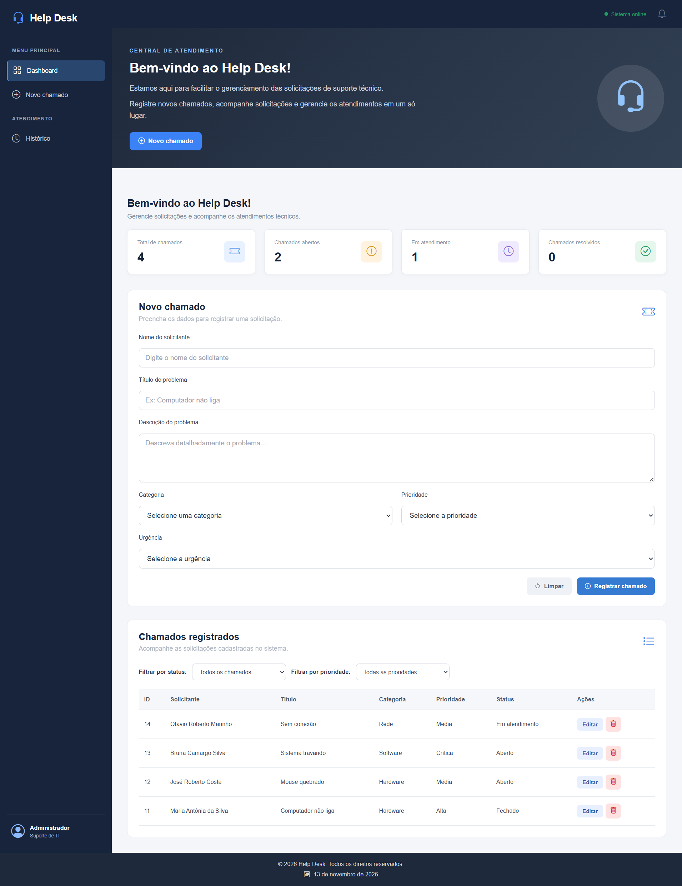

# Sistema de Chamados de TI — Help Desk

Sistema web para gerenciamento de chamados de suporte técnico, desenvolvido para organizar solicitações, acompanhar atendimentos e facilitar o controle das demandas de TI.

## Funcionalidades

- Cadastro de chamados de suporte.
- Consulta dos chamados registrados.
- Filtros por status e prioridade.
- Edição de status, prioridade e urgência.
- Exclusão de chamados.
- Dashboard com indicadores.
- Armazenamento permanente dos dados em banco SQLite.
- Interface responsiva para computadores, tablets e celulares.

## Tecnologias utilizadas

**Frontend**
- HTML5
- CSS3
- JavaScript

**Backend**
- Node.js
- Express

**Banco de dados**
- SQLite
- better-sqlite3

## Estrutura do projeto

```text
help-desk/
├── frontend/
│   ├── index.html
│   ├── css/
│   │   └── style.css
│   └── js/
│       └── script.js
├── backend/
│   ├── server.js
│   ├── database/
│   │   └── db.js
│   └── routes/
├── .gitignore
├── package.json
├── package-lock.json
└── README.md
```

## Como executar o projeto

### 1. Clonar o repositório

```bash
git clone URL_DO_REPOSITORIO
```

### 2. Entrar na pasta

```bash
cd help-desk
```

### 3. Instalar as dependências

```bash
npm install
```

### 4. Iniciar o backend

```bash
npm run dev
```

O servidor será iniciado em:

```text
http://localhost:3000
```

### 5. Abrir o frontend

Abra o arquivo `frontend/index.html` utilizando a extensão Live Server do Visual Studio Code.

## Banco de dados

O projeto utiliza SQLite para armazenar os chamados.

O banco e a tabela são criados automaticamente quando o backend é iniciado pela primeira vez.

## Objetivo do projeto

Projeto desenvolvido com o objetivo de praticar desenvolvimento web, integração entre frontend e backend, operações CRUD, criação de APIs REST e utilização de banco de dados relacional.

